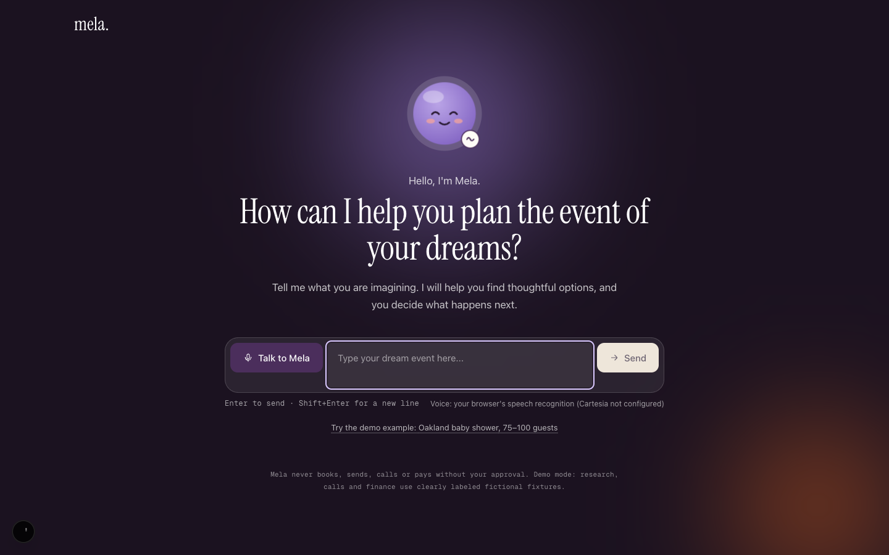
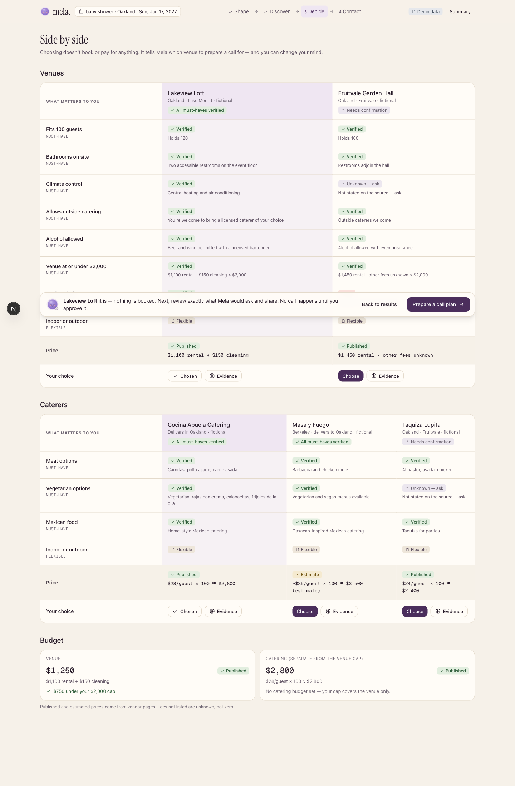
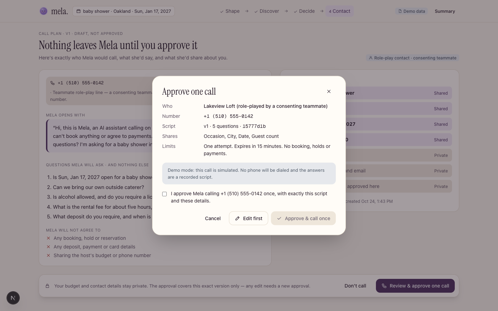
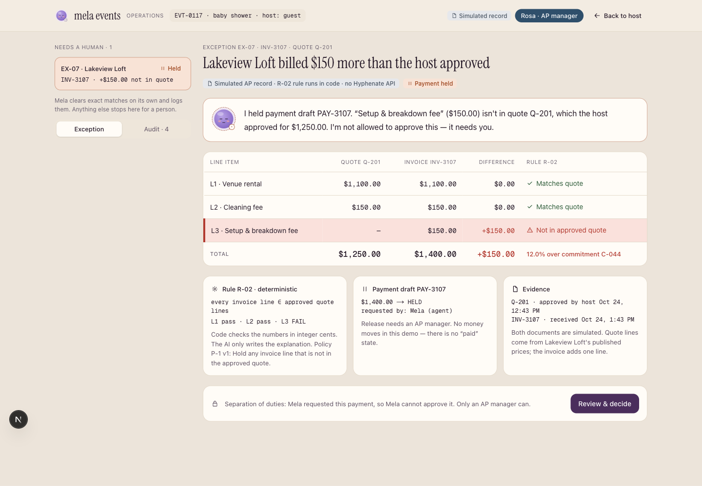
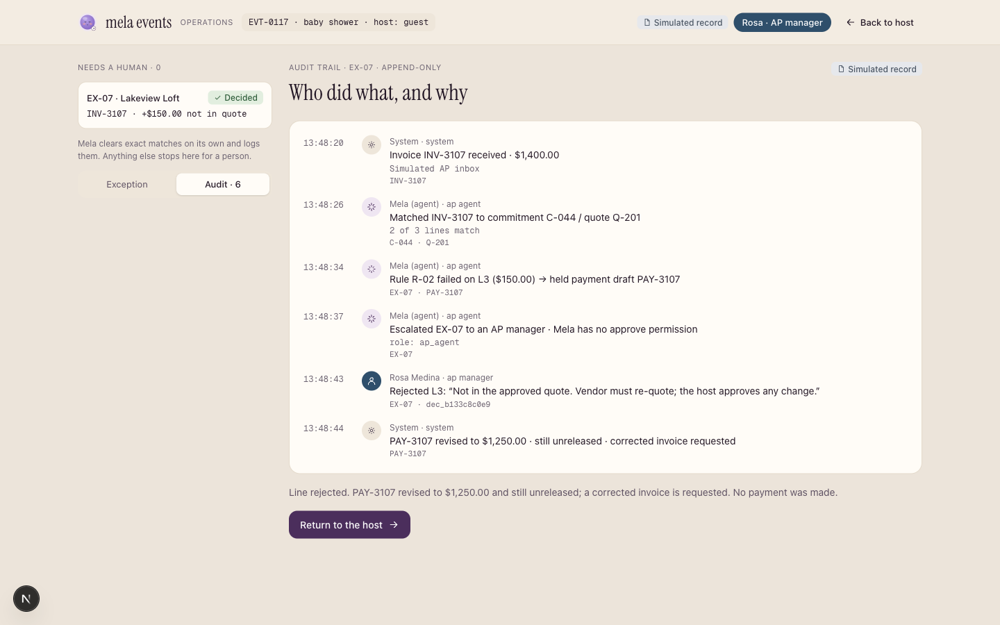
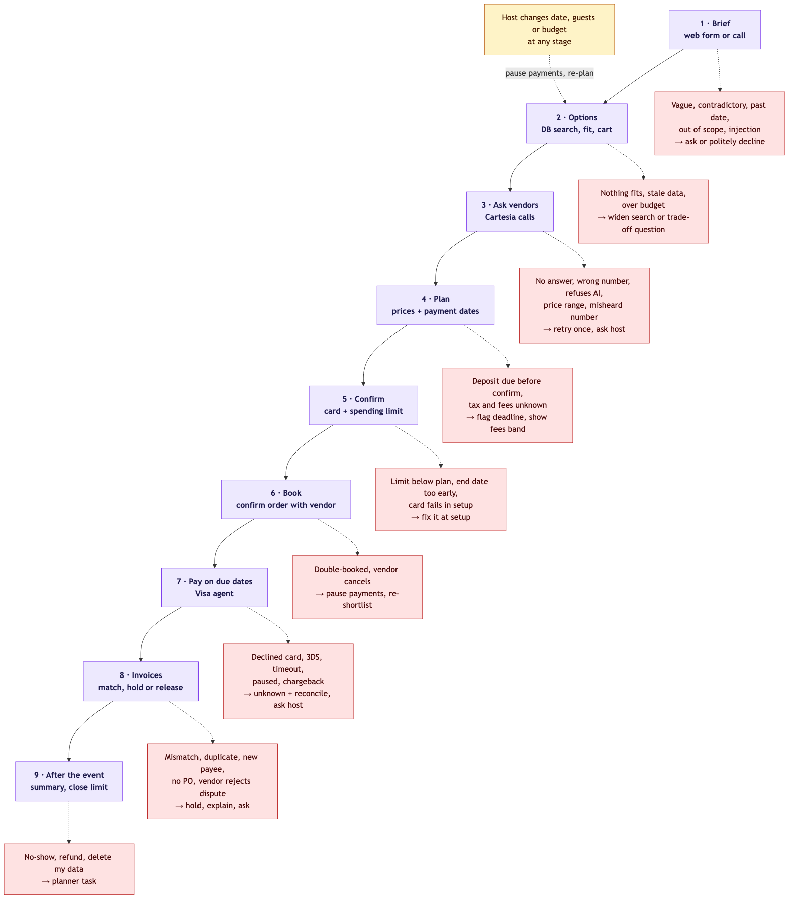

<p align="center">
  
</p>

<p align="center">
  <strong>An AI event planner that does the phone work, and never spends a dollar without you.</strong>
</p>

<p align="center">
  <a href="LICENSE"></a>
  
  
  
</p>

<p align="center">
  
</p>

Describe an event once. Mela researches real venues and caterers from their public pages and shows every fact with its quote and source. It calls you to confirm the brief, calls vendors for availability and prices, and texts you one summary with an approval code. Only after you reply **YES** with that code does it pay deposits (Stripe test mode) and confirm the bookings. Every number is computed in code, every gate is enforced in code, and nothing leaves the system without a person saying so.

Built at Cal Hacks 13.0 by a team of four. MIT licensed.

## Contents

- [See it](#see-it)
- [How it works](#how-it-works)
- [What keeps it safe](#what-keeps-it-safe)
- [Repo map](#repo-map)
- [Run it](#run-it)
- [Tests](#tests)
- [Go live](#go-live)
- [The autonomous flow, end to end](#the-autonomous-flow-end-to-end)
- [Research from the terminal](#research-from-the-terminal)
- [Contributing](#contributing)

## See it

| Discover and compare | Approve one call |
|---|---|
|  |  |
| Choosing books nothing. Each must-have is **verified**, **unknown** or an **estimate**, with the source one click away. | Nothing leaves Mela until you approve it: the exact number, script and shared fields, one attempt, 15-minute expiry. |

| Invoice exception | Audit log |
|---|---|
|  |  |
| An unquoted $350 line isolates the invoice, holds the payment and asks a manager. The agent explains; it does not decide. | Append-only. Every call, text, approval, payment and refusal, with who did it and why. |

More in [`docs/screenshots/`](docs/screenshots/).

## How it works

```
host (web form or voice) ──> intake agent ──> brief + the questions that still matter
                                   │
                                   ▼
                      confirmation call to the host (Cartesia)
                                   │
                                   ▼
   lead agent picks venue / caterer / decor ──> one call per vendor ──> quote agent reads the transcript
                                   │
                                   ▼
          one iMessage: three quotes, total vs budget, "reply YES 4821 to book, or NO 4821"
                                   │
                           host replies YES + code
                                   │
                                   ▼
     CRS vendor check ──> Stripe test-mode deposit per vendor ──> texts and a final call with confirmations
                                   │
                                   ▼
        invoices arrive ──> matched against the purchase order ──> clean: coded YES for the balance
                                                                   odd: held, explained, handed to a person
```

Agents propose. Code decides. The orchestrator in `src/lib/events.ts` owns the event state machine, the per-event lock, idempotency keys and every gate. Agents run on a small harness (`src/agents/harness.ts`) that fences untrusted text, validates every output with zod and retries once at most.

The full stage map with its failure branches is in [`docs/agent-flow.md`](docs/agent-flow.md):

<p align="center">
  
</p>

## What keeps it safe

- **A phone call never moves money.** Only a text reply with the right 4-digit code (or a signed-in dashboard click) approves spending. Codes expire in 30 minutes and are tied to the host's number.
- **No agent output is trusted as a number.** Prices come from the quote agent with a cited transcript line; totals, budget checks and the amount to charge are computed in code.
- **Payments are honest.** Stripe test mode only, and live keys are refused. One idempotency key per vendor, so a retry can never double-charge. An unclear outcome is recorded as `unknown` for a person to reconcile, never retried blind.
- **Vendors are checked before they are paid.** A CRS risk check gates every payment: `block` hides the vendor, `review` refuses the payment and opens a planner task.
- **Texts are templates.** Agents choose which message to send; the words live in `src/lib/notify.ts`. The first text says Mela is an AI assistant. STOP, HELP and PLANNER are honored. Hosts and vendors who chose Hindi, Punjabi or Vietnamese get translated texts and a voice agent in their language, while every record stays in English.
- **Invoices are matched, not paid.** Purchase orders are raised at approval. Incoming invoices are matched (mismatch, duplicate, changed payment details, no PO); anything odd is held and explained, and a clean balance still needs a coded YES.
- **Research shows its work.** Every fact carries a verbatim quote, a source URL and a fetch time, or it is `unknown` with a reason. An ablation run with a bad key must return nothing but `unknown`.
- **Demo mode is labeled.** Without keys the web app runs on fictional vendors and says so on every screen. A live capability with a missing key shows "not connected", never fixture data.

## Repo map

| Area | Where | Notes |
|---|---|---|
| Web app | `src/mela/` | Screens, zod contracts, deterministic rules, demo and live adapters. Design handoff and Figma map: [`docs/design-handoff.md`](docs/design-handoff.md). |
| Agent flow | `src/lib/events.ts`, `src/agents/`, `src/lib/` | Intake, lead, outreach, quote, explainer, translator and finance agents; approvals, payments, rules, templates, vendor risk. Design: [`docs/superpowers/specs/2026-10-24-agent-demo-flow-design.md`](docs/superpowers/specs/2026-10-24-agent-demo-flow-design.md). |
| Channels | `src/integrations/` | Cartesia managed-agent calls, iMessage send and poll on a Mac, Stripe Connect test payments, CRS, Hyphenate-style invoices. |
| Host-approved calls and finance cases | `src/lib/calls/`, `src/lib/finance/`, `src/lib/crs/` | The dashboard path: call plans the host approves one at a time, finance cases with an AP manager decision, OFAC and business checks. |
| Research | `src/lib/research/` | Bright Data fetch and search, Claude extraction with verbatim quotes, verification, Apify vendor discovery, DataSF parks, a cache of real results. [`docs/research.md`](docs/research.md). |
| Texting bridge | `src/lib/texting.ts`, `relay/`, `spacetimedb/` | Optional SpacetimeDB bridge so a backend running off the Mac can still text through the Mac's Messages app. |
| API | `src/app/api/` | `events`, `webhooks/*`, `calls`, `finance`, `research`, `intake`, `voice`, `vendors/:id/risk`. Payloads and modes: [`docs/frontend-integration.md`](docs/frontend-integration.md). |
| Brand | `public/mela-logo.svg`, `public/mela-wordmark.svg`, `src/mela/ui/MelaOrb.tsx` | The orb has ten states; the face carries the meaning, motion only reinforces it. |

## Run it

```bash
npm install
npm run dev            # http://localhost:3000, demo mode: no keys, fictional vendors, labeled as such
```

Click **Try the demo example** on the welcome screen.

## Tests

```bash
npm test                  # agent flow, templates, payments, CRS, invoices, web app, finance
npm run test:research     # research module (fakes, no network)
npm run test:calls        # call routes (fakes, no network)
npx tsc --noEmit
npx next build
```

Tests never hit the network, Stripe, Messages or a phone. The research and calls suites run with `--conditions=react-server` because those modules import `server-only`.

## Go live

Each capability goes live on its own. Copy `.env.example` to `.env.local` (never committed) and fill in what you have. Keys are read only in route handlers and `server-only` modules.

| Capability | Env vars |
|---|---|
| Web app live switches | `NEXT_PUBLIC_MELA_LIVE` (`intake,research,calls,finance` or `all`) |
| Intake, agents, translation | `ANTHROPIC_API_KEY` |
| Voice in the web app | `CARTESIA_API_KEY` (optional `CARTESIA_VOICE_ID`, `CARTESIA_TTS_MODEL`) |
| Research | `BRIGHTDATA_API_TOKEN`, `BRIGHTDATA_UNLOCKER_ZONE`, `BRIGHTDATA_SERP_ZONE` (zone *names*, not keys), `APIFY_TOKEN` |
| Payments | `STRIPE_SECRET_KEY` (must be `sk_test_…`; live keys are refused) |
| Vendor checks | `CRS_USERNAME`, `CRS_PASSWORD`; for OFAC also `CRS_XGS_CONFIG`, `CRS_XGS_GLB_PURPOSE`, `CRS_XGS_DL_PURPOSE`; optional `CRS_BASE_URL` |
| Host-approved calls | `CARTESIA_API_KEY`, `CARTESIA_AGENT_ID`, `CARTESIA_FROM_NUMBER_ID`, `MELA_ROLEPLAY_PHONE` (E.164); optional `CARTESIA_WEBHOOK_SECRET` |
| Autonomous agent flow | the above plus `MELA_HOST_PHONE`, `VENDOR_PHONE_<vendorId>` for each vendor you want called, `CARTESIA_PHONE_NUMBER_ID`, per-language `CARTESIA_AGENT_ID_<LANG>` |

Run one long-lived server for live mode. Research jobs, finance cases, call plans and CRS results live in that process's memory, and the browser polls it:

```bash
npm run build && npm start
```

`NEXT_PUBLIC_*` values are baked in at build time, so rebuild after changing them.

Setup notes:

- **Host-approved call plans** (`/api/calls`): create one Cartesia agent whose greeting is exactly `{{mela_disclosure}}`, with the instructions in `VENDOR_AGENT_SETUP` (`src/lib/calls/cartesia.ts`). Calls on this path only ever go to `MELA_ROLEPLAY_PHONE`. Optional webhook: `https://<host>/api/calls/webhook`.
- **CRS:** the hackathon sandbox has no business-credit or OFAC product confirmed for real vendors; seed vendors map to sandbox personas. Repeated failed logins disable a sandbox account, so the client never retries a failed login.
- **Stripe:** test mode only. The agent flow creates an Express connected account per vendor on first payment and texts the vendor a one-time onboarding link; a hand-made account can be pinned with `STRIPE_ACCT_<vendorId>`.

## The autonomous flow, end to end

This is the path where Mela calls and texts on its own after the host confirms. It needs a Mac for iMessage and real numbers that have agreed to be called.

1. **Cartesia agents.** `npm run cartesia:setup -- --provision --write` finds or provisions a phone number, creates one managed agent per language (`mela-caller-en/hi/pa/vi`) and writes the ids to `.env.local`.
2. **Phones.** Seed vendors in `data/seed.json` carry placeholder 555 numbers. Set `VENDOR_PHONE_<vendorId>` to a consenting teammate's phone for each vendor you want the agent to call, and `MELA_HOST_PHONE` to the host's phone.
3. **iMessage.** The backend sends texts through the Messages app with `osascript` and reads replies from `~/Library/Messages/chat.db`. Grant the terminal Full Disk Access and Automation permission for Messages, then run the poller next to the server:

   ```bash
   npm run dev
   npx tsx scripts/imessage-poll.ts
   ```

   If the backend runs somewhere else, `npm run relay` on the Mac bridges texts through SpacetimeDB instead (see `spacetimedb/`).
4. **Start an event.**

   ```bash
   curl -s -X POST localhost:3000/api/events -H 'content-type: application/json' \
     -d '{"text":"quinceañera in SF for 100, budget 12000, Dec 6","hostPhone":"+1415…","hostName":"Priya"}'
   ```

   Mela calls the host to confirm, calls each vendor, texts each quote, texts the approval request, and after a `YES <code>` reply pays the deposits and calls the host back. `GET /api/events/:id` shows the event with its calls, quotes, approvals, payments, messages and audit log. `POST /api/events/:id/invoices` feeds an invoice into the matching flow.

## Research from the terminal

```bash
npm run research:fetch -- https://palaceoffinearts.com/ --find "capacity"
npm run research:run -- --url https://palaceoffinearts.com/ --name "Palace of Fine Arts" --vendor "caterer"
npm run research:parks    # SF parks from DataSF, no keys
```

These load `.env.local`. Results are cached in `.research-cache/`; add `--fresh` to skip the cache.

**Ablation test** (proves nothing is hardcoded): every fact must come back `unknown` / `source_failed`.

```bash
BRIGHTDATA_API_TOKEN=bad npm run research:run -- --url https://palaceoffinearts.com/ --name "Palace of Fine Arts" --fresh
```

## Contributing

Pull requests are welcome. Keep the properties in [What keeps it safe](#what-keeps-it-safe) intact: no agent output trusted as a number, no payment without a coded approval, no quiet fallback to fixture data when a live key is missing. Add a test next to the behavior you change; `npm test` must stay green without network access.

## License

[MIT](LICENSE). Copyright 2026 Mela contributors.
