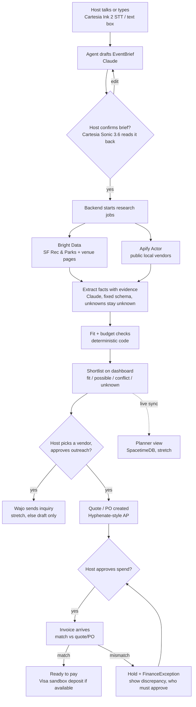

# Mela: agent workflow and sponsor stack

Draft, Oct 23 2026. Source: `CalHacks 13.0 Planning.docx`.

## What it does

A host describes their event by voice or text. Mela turns it into a brief the host confirms, researches live public sources, and returns a short shortlist where every fact links to its source. Any outreach, booking or spending waits for the host to approve it.

The rule we follow everywhere:

- **The model interprets.** It pulls the brief out of conversation, turns web pages into facts, and explains trade-offs.
- **Code decides.** Budget math, capacity/date/deadline checks, invoice matching, approval policy and state changes are plain code.
- **The host approves.** Outreach, reservations, purchase orders, deposits and payments.

Demo scenario: an outdoor, family-centered quinceañera in San Francisco for about 100 guests, with step-free access, a firm budget and food preferences. The brief values are demo inputs. Venue and city facts must be fetched live.

## Workflow

Every step writes an `AuditEvent` (who, what, when, why).

## Step by step

| # | Step | What happens | Tech / sponsor | Owner | Needs host approval |
|---|------|--------------|----------------|-------|---------------------|
| 1 | Intake | Host describes the event. Text box always works. | Cartesia Ink 2 (speech to text, turn detection) or Managed Agents | Tanush | – |
| 2 | Draft brief | Model fills `EventBrief`: type, location, date window, guests, budget, access, dietary, preferences (must-have / preferred / flexible). Asks only for missing high-impact fields. | Claude | Chanpreet | – |
| 3 | Confirm brief | Brief shown as an editable form and read back aloud. | Cartesia Sonic 3.6 | Tanush | Yes, the host confirms |
| 4 | Research | Backend runs bounded fetch jobs with timeout and retry. Each source shows searching / found / slow / blocked / empty. | Bright Data (server-side REST, Web Unlocker zone) | Matthew | – |
| 5 | Vendor discovery | One Actor returns public local vendors (caterers, décor), normalized. | Apify (`apify-client`) | Matthew | – |
| 6 | Extract facts | Page text → `ExtractedFact` (field, value, evidence snippet, source URL, fetched_at). Missing = unknown, never guessed. | Claude, structured output | Chanpreet + Matthew | – |
| 7 | Fit and budget | Capacity, date, deadline (e.g. SF permit 60 days ahead, $85 fee), access, budget totals. Each venue gets fit / possible / conflict / unknown with a reason. | Plain TypeScript | Chanpreet | – |
| 8 | Shortlist | Small set of options with fit reasons, known costs, open questions, contacts, next actions. | Next.js dashboard | Tanush | – |
| 9 | Outreach | Exact message shown, sent only after approval. Reply saved to contact history. | Wajo (stretch). Fallback: draft only, marked "not sent" | Chanpreet | Yes |
| 10 | Commit spend | Quote → purchase commitment/PO under the host's rules. A PO does **not** reserve the venue; booking is a separate venue action. | Hyphenate API if available, else a labeled local prototype | Chanpreet | Yes |
| 11 | Invoice match | Invoice vs approved quote/PO: vendor, line items, amount, terms, payment details. Demo case: the caterer's invoice differs from the quote. Hold it, cite the difference, show who must approve. | Plain TypeScript; Claude only explains | Chanpreet | Yes, to release a held invoice |
| 12 | Deposit | Optional test deposit after separate approval. Labeled sandbox; no real money. | Visa sandbox only if Visa confirms access | Chanpreet | Yes |
| 13 | Shared workspace | Planner sees the same brief, shortlist, budget, tasks in real time. | SpacetimeDB (stretch), else plain DB | Tanush | – |

Owners follow the first team split in the planning doc. Change them if the team agreed differently.

## Sponsor stack

| Sponsor | What we use it for | Priority | Access to confirm |
|---------|--------------------|----------|-------------------|
| Bright Data | Live public city and venue pages. Without it the recommendation changes or disappears. | Core | API key (`BRIGHTDATA_API_TOKEN`), Web Unlocker zone. Start with the Cal Hacks Public Data Hackpack. |
| Claude | Brief extraction, page-to-facts with evidence, plain-language explanations. | Core | API key |
| Hyphenate | Procure-to-pay story: quote/PO, approval routing, invoice match, exception hold, audit trail. Primary finance track. | Sponsor depth | Is there a real API or sandbox? If not, say "prototype adapter". |
| Cartesia | Voice intake (Ink 2) and spoken confirmations (Sonic 3.6). Voice confirms the brief and calls our backend; it never scrapes. | Sponsor depth | API key; Managed Agents vs raw STT/TTS |
| Visa | Vendor comparison as a shopping decision; host-approved test deposit. Reimagining Shopping track. | Sponsor depth | Which sandbox/product they expect; credentials |
| Microsoft | Production story: observable jobs, safe secrets, approvals, clear limits. Host on Azure only if deploy is easy. | Story | Azure for Students, if used |
| Apify | One Actor for public local vendor info. | Nice to have | Credits, MCP setup from the sponsor deck |
| Wajo | Approved vendor call/email to fill a missing detail. | Stretch | Code `CALHACKS` at wajo.ai/join; which API/MCP actions we get |
| SpacetimeDB | Live host/planner sync. | Stretch | React quickstart works fast enough? |
| Next.js / TypeScript | Whole app: UI plus API routes. Keys stay server-side. | Core | – |

## What can fail and what we show

| Failure | What the host sees | Fallback |
|---------|--------------------|----------|
| Bright Data page slow | Source card says "slow", keeps retrying (bounded) | None needed; never swap in hardcoded facts |
| Page blocked or empty | Card says "blocked" / "no result" | Retry button; fact stays unknown |
| Model returns bad JSON | Field stays unknown | Validate against schema, retry once |
| Cartesia down | Text box | Text intake is always there |
| Hyphenate API not available | "Prototype adapter" label on the finance panel | Local AP workflow in our backend |
| Visa sandbox not available | Deposit step hidden | Show approved amount as "pending, not paid" |
| Wajo not available | Draft with "not sent" | Host copies the message |

No mocked venue or vendor facts in the judged flow. Any dev cache stays out of the demo path.

## Ask at the booths tonight

1. **Hyphenate:** Is there an API or sandbox for the hackathon? Which finance step do judges care about most?
2. **Visa:** Which product or sandbox counts for Reimagining Shopping? Do we need a real sandbox payment?
3. **Bright Data:** Confirm the prize track and the rule on live data in the judged demo.
4. **Cartesia:** Managed Agents or Ink 2 + Sonic 3.6 directly: which is faster to get working?
5. **Wajo:** Which actions can we call, and is there a safe test mode?
