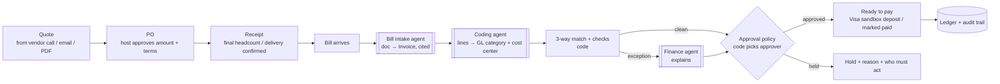

# Mela × Hyphenate: finance agent plan

Draft, Oct 23 2026. Builds on `docs/multi-agent-harness.md`.

## Framing

The Hyphenate track wants a company's finance function. So the company here is **the planner business** that runs events for hosts. It holds the vendor commitments and pays the bills. The host is that business's client.

- **Planner's AP team** (our finance agents + a planner approver) handles routine bills.
- **The host** approves anything that changes what they agreed to: a higher amount, new line items, a new payment method or a deposit.

This settles the "host or planner?" question from the doc review: both, split by policy. The policy itself lives in code.

## The finance lifecycle

| Step | Agent / code | What it does |
|------|--------------|--------------|
| Bill intake | **Bill Intake agent** (Claude) | Vendor email, PDF or call transcript → structured `Quote` / `Invoice` with line items, terms, due date and payment details. Every field cites its line in the document |
| Coding | **Coding agent** (Claude) | Each line → GL category (venue, catering, décor, rentals, permits, fees) + the event's cost center. Low confidence → sent to a human |
| Match + checks | Code | 3-way match (PO vs invoice vs receipt), plus duplicate, payment-change, vendor-status and budget checks |
| Policy | Code | Who has to approve, based on amount, change from PO and vendor status |
| Explain | **Finance agent** (Claude) | Turns the list of differences into one short note: what changed, by how much, where in the document |
| Hold / release | Human gate | The approver releases, holds or disputes. Nothing pays itself |

## Use cases

Each card: **trigger → steps → what people see → pass check.** The pass check is the test we write in `rules.test.ts`, plus one demo run.

Demo numbers used throughout: caterer quote **100 guests × $45 = $4,500**, deposit 30% due 14 days before the event, refundable until 21 days before. Host's catering budget: $5,000.

### UC1. Invoice doesn't match the PO (hero, build first)

- **Trigger:** caterer sends an invoice for **120 × $45 = $5,400 + 20% service charge $1,080 = $6,480**.
- **Steps:**
  1. Bill Intake reads the invoice, and Coding categorizes both lines as catering.
  2. Match fails on two lines: quantity 120 vs PO 100 vs receipt 100 (+$900), and a new line not on the PO (+$1,080). The total is $1,980 over the PO.
  3. Policy: a change vs the PO means the host approves. Over the $5,000 budget is noted too.
  4. The Finance agent writes the note, citing the invoice lines.
- **What people see:**
  - iMessage: "Held [caterer]'s invoice: billed 120 guests (you confirmed 100) and added a 20% service charge not in the quote. $1,980 over. Review →"
  - Dashboard: side-by-side PO vs invoice with both lines highlighted, and buttons for *Approve 100 guests · Dispute charge · Approve all*.
  - If the host picks *Dispute charge*: Outreach drafts the reply, and once the host approves it, the Cartesia vendor agent calls the caterer.
- **Pass:** two exceptions with the right amounts; status `held`; the approver is the host; nothing is marked payable until the host acts; every step is in the audit log.

### UC2. Bank details changed

- **Trigger:** an invoice arrives with payment instructions that differ from the vendor record.
- **Steps:**
  1. Code sees `invoice.paymentInstructions ≠ vendor.paymentOnFile` and places a **hard hold**, whatever the amount and even if UC1 is clean.
  2. Lead → `request_approval` for a verification call.
  3. The Cartesia vendor agent calls the number **on file** and asks one question: "Did you change your bank details?"
  4. The transcript is saved. A person still has to clear it.
- **What people see:** iMessage "⚠️ [caterer]'s invoice has new bank details. Held until verified." Dashboard shows old vs new (masked), call transcript, and *Clear* only for planner lead **and** host.
- **Pass:** the agent can't clear it (the tool refuses); clearing needs two approvals; the call goes only to the number on file.

### UC3. Unverified vendor

- **Trigger:** the first bill from a vendor whose badge is **Check first** (a contradicted fact, CRS review, or CRS no match). **Updated Oct 24:** `no signal` alone (no public reviews) with CRS clear counts as Trusted and is not blocked.
- **Steps:**
  1. Code blocks the **first payment** to that vendor.
  2. Lead can `request_refresh(vendor)` to re-run the update job.
  3. If it's now `confirmed`, the block lifts automatically. Otherwise a human has to confirm.
- **What people see:** dashboard badge "Vendor not verified: [field] contradicted by [post link]." There's no text unless the payment is due within 3 days.
- **Pass:** the first payment is blocked when verification isn't `confirmed`; the refresh is rate-limited; later payments to a verified vendor aren't blocked.

### UC4. Duplicate invoice

- **Trigger:** same vendor plus the same invoice number, **or** the same amount within 7 days.
- **Steps:** code holds the new bill and links the original. The Finance agent says which rule matched.
- **What people see:** dashboard "Possible duplicate of INV-123 (paid Oct 20)" with *Not a duplicate* / *Reject*.
- **Pass:** both patterns are caught; a different amount from the same vendor isn't flagged.

### UC5. Deposit and cancellation deadlines

- **Trigger:** a quote is turned into a PO.
- **Steps:**
  1. Bill Intake pulls the terms out of the quote (deposit 30%, due date, refund-by date).
  2. Code creates two dated tasks.
  3. When a deadline is 3 days away, `notify` sends a text.
- **What people see:** dashboard timeline "Deposit $1,350 due Nov 1 · refund window closes Oct 25". iMessage at T-3 days.
- **Pass:** dates are computed in code from the event date; missing terms show as *unknown*, never a default.

### UC6. Permit fee as a payable (live data → finance)

- **Trigger:** the Bright Data update job confirms SF Rec & Parks: **$85 application fee, file 60+ days before the event**.
- **Steps:** code creates a payable to "SF Recreation & Parks", $85, due *event date − 60 days*, coded as permits, with a source link.
- **What people see:** dashboard "Permit application $85 due by [date]" with the source link and fetched time. If the date has already passed, it shows as a **conflict** on the shortlist.
- **Pass:** the fee and deadline come from the DB fact, not hardcoded; changing the event date moves the due date; a stale or blocked source shows its status.

### UC7. Budget variance

- **Trigger:** any PO or bill changes the committed or invoiced total.
- **Steps:** code keeps *budget / committed / invoiced / paid* per category. If a bill would push a category over budget, the approver for that bill moves up to the host.
- **What people see:** dashboard budget bars per category. In UC1, catering shows **$6,480 invoiced vs $5,000 budget**.
- **Pass:** the totals add up exactly (integer cents); going over budget changes the approver.

### Build order

UC1 → UC2 → UC6 → UC3 → UC7 → UC4 → UC5. UC1 + UC2 make the demo. UC6 and UC3 tie our live data layer into finance, which is what sets us apart.

**Cut if short on time:** partial payments, multi-currency, tax rules beyond one flat rate, and vendor 1099s.

## Approval policy (code, one function)

| Condition | Approver |
|-----------|----------|
| Matches PO, under $500, vendor verified | Planner AP, one click |
| Matches PO, $500 or more | Planner lead |
| Any change vs PO (amount, quantity, new line) | Host |
| New payment details | Hard hold → out-of-band verify → planner lead **and** host |
| Vendor unverified or duplicate suspected | Hold, no release until resolved |

Dollar thresholds are placeholders; the planner business sets them. The policy takes the strictest matching row.

## New records

`PurchaseOrder`, `Receipt` (confirmed headcount/delivery), `FinanceException { kind: "mismatch" | "payment_change" | "unverified_vendor" | "vendor_risk" | "duplicate" | "over_budget", lines, approver, status }`, `GLCode`. These go into `types.ts` with the data team's `Vendor` shape.

## Hyphenate integration

- **If they give us an API or sandbox:** push PO, invoice and approval status there. Hyphenate becomes the record, and our agents are the intake/explain layer on top.
- **If not:** run the same flow in our backend behind `src/integrations/hyphenate.ts`, labeled "prototype adapter" in the UI. Never call it Hyphenate-connected if it isn't.

## Ask at the Hyphenate booth

1. Is there an API or sandbox, and which objects does it take (bills, POs, approvals)?
2. Which do judges weigh most: intake/coding accuracy, matching, or the exception workflow?
3. Do they want GL coding against a real chart of accounts, or is a small fixed set fine?
