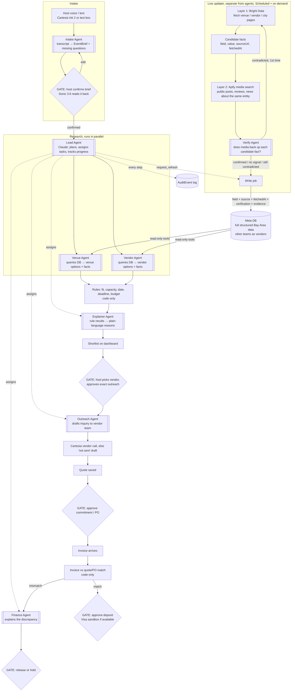

# Mela: multi-agent flow and harness

Draft, Oct 23 2026. Builds on `docs/agent-workflow.md`.

## Shape in one line

**A Claude Lead agent assigns tasks. Its tools are the specialist agents, the rules and the gates. Code owns the gates, the rules and the money.** The Lead decides what to do next. It can't skip a gate, change a rule result or move money, because those tools are plain code that refuses.

Scope for the demo: the **Bay Area**. Vendors are **other Cal Hacks teams** acting as caterers, décor and so on, loaded from our team's structured dataset. Bright Data updates that dataset live, and Apify media search double-checks each update.

## Flowchart



`[[ ]]` = Claude agent. `{ }` = human gate. Everything else is code.

## Lead agent

One Claude agent per event. It gets the confirmed brief and works through the plan by calling tools. Each specialist agent is a tool that runs `runAgent()` on that specialist and returns its result.

| Tool the Lead can call | What runs | Code-enforced limits |
|------------------------|-----------|----------------------|
| `find_venues(brief)` | Venue agent (DB tools) | Read-only |
| `find_vendors(brief, category)` | Vendor agent (DB tools) | Read-only |
| `check_fit(options)` | `rules.ts` | Plain code: the Lead gets the result and can't change it |
| `explain(results)` | Explainer agent | – |
| `publish_shortlist(items)` | Writes to the dashboard | Each item must already have passed `check_fit` |
| `draft_outreach(vendor, questions)` | Outreach agent | Returns a draft only |
| `request_approval(action)` | Creates a gate on the dashboard | Returns `pending`. The Lead's run ends here |
| `send_outreach(approvalId)` | Cartesia outbound call | Refuses unless that approval ID is `approved` and the message matches it |
| `process_bill(document)` | Bill intake → coding → match → policy (see `hyphenate-plan.md`) | Match and policy are code |
| `request_quote(vendorId, approvalId)` | Cartesia vendor call (Fetch.ai vendor agent later, if needed) | Refuses without an approved outreach |
| `ask_human(to, question, options, why, blocking, deadline?)` | Creates a `HumanTask` for the host or planner, sends it on the host's channel (web chat / iMessage / Cartesia call) with polite wording. The Lead's run ends | Must-have, money and personal-data questions are always `blocking`. One reminder, then planner. Quiet hours 9am–8pm |
| `request_refresh(entity)` | Triggers the updater for one venue/vendor | Rate-limited |
| `build_cart(options)` | Shopping bundles with totals + trade-offs (see `visa-plan.md`) | Plain code |
| `request_payment_approval(poId, kind)` | Creates a pending Mandate + dashboard gate. The Lead's run ends | Needs an approved PO |
| ~~`pay`~~ | **Removed from the Lead (Oct 24).** A scheduled job in SpacetimeDB pays on due dates after code checks; see `agent-flow.md` §3 | The Lead can't move money at all |

**How a run goes:**
1. Brief confirmed → Lead run starts.
2. Lead calls `find_venues` and `find_vendors` in parallel, then `check_fit`, `explain` and `publish_shortlist`.
3. Lead asks for approvals with `request_approval`, and its run ends with a short status: done, waiting, open questions.
4. When the host approves something, or a bill or vendor reply comes in, the backend starts a **new** Lead run with the event state and the new input. It's a fresh run each time, not one long conversation, so state lives in the DB and not in the Lead's context.

**Why this shape:** judges see a real lead agent planning and handing out work, while every gate and dollar is still enforced in code. If the Lead goes wrong, the worst it can do is call tools in a poor order, and the dashboard and audit log show that.

**Safety loop:** every Lead step follows the loop in `agent-flow.md` §1 (dedupe, one run per event, one-time keys, retry once, honest fallbacks).

**Limits:** the Lead gets about 15 tool calls per run (`max_iterations`). Specialist agents get no tools that could start another specialist, so delegation is one level deep.

## Agents

| Agent | Input | Output (schema) | Tools / data | Never does |
|-------|-------|-----------------|--------------|------------|
| Intake | Transcript or typed text | `EventBrief` draft + list of missing high-impact fields | None | Guess budget, date or identity traits |
| Venue | Confirmed brief | Venue options + facts (each with source + fetchedAt from the DB) | Read-only DB tools, e.g. `search_venues`, `get_venue` | Write to the DB; fill a value the DB doesn't have |
| Vendor | Confirmed brief | Vendor options + facts | Read-only DB tools, e.g. `search_vendors`, `get_vendor` | Write to the DB; contact a vendor |
| Verify (runs inside the update job) | Candidate facts from Bright Data for one venue/vendor + Apify media results for it | Per fact: `confirmed / contradicted / no signal`, a quoted snippet and the media URL | None. Bright Data and Apify run in code first | Write to the DB itself (the write job does); change a value; call something confirmed without a quote |
| Explainer | Rule results (fit/conflict/unknown + numbers) | `reasons[]` per option | None | Change a fit status or do arithmetic |
| Outreach | Chosen vendor, brief, open questions | `{ recipient, subject, body }` | None | Send. Code sends after the gate |
| Finance | Quote, invoice, discrepancy list from code | Plain-language explanation | None | Approve, pay, or change payment details |

**Agents never call Bright Data or Apify.** They only query the DB. Bright Data and Apify feed a separate update job that keeps the DB fresh. Agent runs stay fast and predictable, and a slow or blocked page never stalls an agent. The update job records each source's `found / slow / blocked / empty / partial` status, and the dashboard reads it from there.

## Other companies' agents we plug in

Our own agents are Claude. These are other companies' agents and tools, and where each one sits. They all follow the same rule: **the Lead agent reaches them only through code-guarded tools, or they call our backend. They never hold the decision.**

| Company | Their agent / product | Where it sits | What it's allowed to do | Our fallback | Status |
|---------|-----------------------|---------------|-------------------------|--------------|--------|
| Cartesia | Line voice agents + managed phone number: **host agent** (inbound) and **vendor agent** (outbound) | Front of Intake + after gate G2 | Host agent: take the task, read the brief back, call `start_task`. Vendor agent: read only the approved script, return the transcript | Text box / 'not sent' draft | Prize: Best Use of Cartesia. Confirm Line + numbers on hackathon credits |
| Bright Data | Web Unlocker (REST); MCP only while exploring | Updater layer 1 | Fetch public, logged-out pages | Fact stays as-is, source shows "blocked" | Confirm key + zone |
| Apify | Actors for media search | Updater layer 2 | Search public posts/reviews/news for one entity | Fact saved as `no signal` | Pick Actor(s) |
| Hyphenate | Procure-to-pay (PO, approvals, invoice match) | After gate G3 | Record the PO, route the approval, check the invoice match | Local prototype, labeled as one | Ask: API or sandbox? |
| Visa | Intelligent Commerce / Agent MCP if available; Developer MCP for docs | Cart (V1) + payment gates (V2, V3) | Pay only within a host-approved Mandate, checked by code | "approved, not paid" | Prize: Reimagining Shopping ($5k). Ask: which product, runtime sandbox? |
| CRS | Credit data API: business credit, public records, OFAC, OTP identity check (see `crs-plan.md`) | Automatic on first PO + big approvals | Vendor risk check before the first deposit; host one-time passcode before big approvals | Risk shown as "not checked", deposit stays blocked | Prizes: Best Financial AI Agent $500, Identity/Fraud. Get sandbox invite |
| SpacetimeDB | Realtime DB; reducers run the gates (see `extra-tracks-plan.md`) | Live event state for host + planner dashboards | Hold brief, tasks, cart, approvals, holds, payments, audit; push live updates | Plain DB + polling | **Core now.** Prize to confirm |
| Fetch.ai | uAgents on Agentverse + Chat Protocol; ASI:One | Vendor quotes agent-to-agent (F1); a third way for hosts to reach Mela (F2) | Ask for approved quotes; forward host chats to `start_task` | Cartesia vendor call; phone/web | **Later, if needed.** Prize: $1,250 / $750 / $500 + interviews |
| Anthropic | Claude (all our agents) | Everywhere | Interpret, extract, plan, explain | – | Best Use of Claude (confirm for 13.0) |
| Microsoft | Azure hosting (not an agent) | Deployment | Host the app and the update job | Vercel / local | Optional |

**Rules for external agents:**
- Their keys stay server-side. The browser never talks to them directly.
- Anything outward-facing or involving money (vendor call, Hyphenate PO, Visa deposit) runs only after its gate, and the approval ID goes with the call.
- Every call and every reply writes an `AuditEvent`.
- Each one sits behind one small adapter file in `src/integrations/`, so falling back means swapping that file.

## Harness

`src/agents/harness.ts` holds one function, `runAgent(spec, input, audit)`:

1. One SDK tool-runner run on `claude-opus-5-5`. The SDK loops until the agent stops calling tools, and the final answer must match the agent's Zod schema.
2. Tools are optional and read-only (DB queries). Agents with no tools are a single call.
3. Bad or refused output → retry once → still bad → return `null`. The caller treats `null` as **unknown**, never as a guess.
4. Every run appends an `AuditEvent` (agent name, ok / failed, when).

Each agent is a file exporting an `AgentSpec`: a name, a system prompt, a Zod schema and optional tools. Adding an agent means adding one file, with no changes to the harness.

## File layout

```
src/
  agents/
    harness.ts         runAgent()  ← exists
    lead.ts            Lead AgentSpec + its tools (wrap specialists, rules, gates)
    intake.ts          AgentSpec<EventBrief draft>
    venue.ts           AgentSpec + DB tools
    vendor.ts          AgentSpec + DB tools
    explainer.ts       AgentSpec<reasons>
    outreach.ts        AgentSpec<draft message>
    finance.ts         AgentSpec<explanation>
    dbTools.ts         read-only DB tools shared by venue + vendor agents
  updater/
    run.ts             one pass: Bright Data → Apify verify → (re-fetch once on contradiction) → write DB
    brightdata.ts      layer 1: fetch page → candidate facts
    apify.ts           layer 2: media search for an entity → normalized posts/reviews
    verify.ts          Verify AgentSpec
  integrations/        one adapter per external company, each with a fallback
    cartesia.ts (host + vendor calls)  hyphenate.ts  visa.ts  sendblue.ts
  lib/
    types.ts           shared contract  ← exists
    db.ts              DB access (shape comes from the data team)
    events.ts          event state in DB: draft → confirmed → researching → shortlisted → outreach → committed → invoiced; starts a Lead run on each new input
    rules.ts           fit, budget, deadline, invoice match (pure functions + one self-check)
  app/api/
    events/route.ts                 POST /events
    events/[id]/research/route.ts   POST /events/:id/research
    events/[id]/results/route.ts    GET  /events/:id/results
    actions/[id]/approve/route.ts   POST /actions/:id/approve
```

## Data: one DB, kept live

**Update (Oct 23):** the vendor and venue tables live in **SpacetimeDB**, next to the live event state, so there's one database. The update job writes to them, and the Venue and Vendor agents read them through `dbTools.ts`.

- The DB starts with the data team's full structured Bay Area dataset. Every field carries `source: "seed" | "brightdata"`, `sourceUrl`, `fetchedAt` and `verification`.
- **Layer 1, Bright Data**, is where updates come from. It fetches pages and produces candidate facts.
- **Layer 2, Apify**, is a check, not a source. It searches public media (posts, reviews, news) for the same venue or vendor, and the Verify agent marks each candidate fact as:
  - `confirmed`: media backs it up, with a quote and link.
  - `contradicted`: media disagrees. Bright Data re-fetches once (the loop). If the fact is still contradicted, it's written with that flag and shows as a conflict on the shortlist with both links. It is never silently fixed.
  - `no signal`: media says nothing. The fact is written as Bright Data-only.
- A candidate fact replaces a DB value only when Bright Data actually found a value. Apify never changes a value; it only sets `verification`.
- The dashboard shows source, age and a verified badge on every fact. For the demo, the vendors are other teams, so their own public posts can confirm or contradict their listing live.

**Contract change needed in `types.ts`:** add `source`, `sourceUrl` and `fetchedAt` to `ExtractedFact`. Also add `Vendor`, `PurchaseOrder`, `FinanceException` and `ActionDraft`. Do this once the data team's structure lands, so the shapes match their dataset.

## Open questions

1. **Bright Data's live-data rule.** The judged demo needs live public data that changes the result. During the demo, trigger the update job on demand so a Bright Data refresh visibly changes a fact (e.g. the SF permit deadline or fee), and the agent's answer changes with it. Check with Bright Data that this counts.
2. **Which media sources and Actors.** Public, logged-out data only (from the planning doc's trust rules). Pick Actors that work without a login, and check each platform's terms.
3. **What the data team's structure looks like.** Its fields decide the `Vendor` type and the merge keys.
4. **Who approves spending: host or planner business?** (Hyphenate framing, still open from the doc review.)

## Vendor reputation (Oct 23)

The update job now runs three checks per vendor: Bright Data (facts) → Apify (media) → **CRS (business standing)**. Code combines them into one badge stored in SpacetimeDB: Trusted / Check first / Not recommended. `check_fit` hides Not recommended vendors and shows Check first with the reason. Details in `crs-plan.md` (C0).

## When an agent needs a person

See Part 3 of the Mela Agent Flow page for the full host, vendor and planner scripts.

- Who gets asked: **host** (anything about their event or money), **vendor** (only after the host approves contacting them; Cartesia call), **planner** (staff judgment, no reply after one reminder, stuck runs).
- Record: `HumanTask { id, eventId, to: "host" | "planner", question, options[], why, blocking, deadline?, status: "open" | "answered" | "escalated", answer? }`, stored in SpacetimeDB.
- Waiting rules: never continue past a must-have, money or personal data without an answer. No reply never means yes.
- Vendor calls always open with: AI assistant, calling for a client, recorded and transcribed (California needs everyone's consent to record), and "is now a good time?". Mela never agrees to prices, dates or terms.

