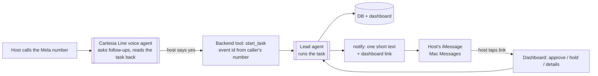
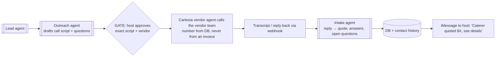

# Mela: phone call → iMessage → dashboard

Draft, Oct 23 2026. Builds on `docs/multi-agent-harness.md`.

## The loop

**Update (Oct 23):** the web form is now the main way in. The host picks how Mela reaches them, **"call me" (Cartesia calls the host) or "text me" (iMessage)**, and every update goes out that way. Vendor and venue data live in SpacetimeDB. When the host picks specific vendors, the Lead asks them through Cartesia vendor calls (Fetch.ai vendor agents later, if needed), then sends the answers back on the host's channel. Calling Mela still works as a second way in.


The host **calls Mela** and asks for something in plain words. The agents do the work, the host **gets an iMessage** with the result, and the **dashboard** holds everything in full.



## Who does what

| Part | Pick | Why | Fallback |
|------|------|-----|----------|
| Phone call | **Cartesia Line** with a Cartesia-managed number (inbound) | Sponsor track. Gives the number, speech-to-text, voice and turn-taking in one, and calls our backend as a tool | Twilio number assigned to the Cartesia agent; or the web voice button |
| Texts | **Mac Messages app** for the demo (Sendblue later) | Real blue-bubble iMessage sent from the demo Mac via AppleScript; replies read from its Messages database. No signup needed | Twilio SMS (arrives in Messages as green SMS) |
| Outbound calls to vendors | **Cartesia Line**, same stack, outbound from the managed number | One voice stack for both directions; we write the agent, so it reads exactly the approved script. Strengthens "Best Use of Cartesia" | Draft marked "not sent"; host calls themselves |
| Dashboard | Next.js, same event ID | Full detail lives here; texts are just pointers | – |

## Vendor calls (Cartesia)

Cartesia handles both sides: the host calls in, and the agent calls vendors out. They're two Line agents (host agent, vendor agent) sharing one backend.



- The vendor agent only asks the approved questions. It can't agree to prices, dates or terms on the host's behalf; anything like that comes back as "vendor proposed X".
- Every call keeps its transcript, time and outcome in the vendor's contact history.
- Hyphenate case 2 (changed bank details): the vendor agent calls the number **already on file** to verify. The planner still has to clear the hold.
- Fallback: the Outreach draft shows as "not sent", and the host can call the vendor themselves.

## What the call can and can't do

- **Can:** start or change a task ("find a caterer that does vegetarian for 100", "move the date to May"), ask for status, and confirm the brief out loud (gate G1).
- **Can't:** approve spending, release a held invoice, or approve outreach. Caller ID can be faked, so those approvals happen on the dashboard (signed-in host) only. The voice agent says, "I've sent you a link to approve that."
- The voice agent never runs research itself. It calls one backend tool, `start_task(eventId, request)`, and the Lead agent does the rest. Matches the planning doc: *Cartesia confirms and calls the backend; it does not scrape.*

## Texts the host gets

One short message per meaningful moment, each with the dashboard link:

| When | Text |
|------|------|
| Task accepted | "Got it, looking for vegetarian caterers for 100 guests. I'll text you when I have options." |
| Shortlist ready | "3 caterers fit your brief. Top pick: [name], $X est. See all → link" |
| Approval needed | "Ready to message [vendor] about a quote. Review and approve → link" |
| Invoice held | "Held [caterer]'s invoice: billed 120 guests, quote was 100, plus a new 20% charge. Review → link" |
| Source problem | "Couldn't confirm [venue]'s capacity (site blocked). Marked unknown → link" |

Rules: no more than one text per state change, no money amounts beyond what the host already knows, and no guest-level personal data in texts.

## Backend pieces

```
src/integrations/
  cartesia.ts     voice agent config + start_task webhook handler
  imessage.ts     sendText(to, body), pollReplies()  → falls back to twilio SMS
src/app/api/
  voice/start-task/route.ts   called by the Cartesia agent; verifies Cartesia's signature
  messages/inbound/route.ts   host texts back → treated like a new request, never as an approval
src/lib/notify.ts             decides when to text (state change → template above)
```

`notify.ts` is plain code reacting to event state changes, not an agent. That keeps the texts predictable.

## Demo script

1. Presenter calls the Mela number on speaker: "I'm planning an outdoor quinceañera in SF for about 100 people…"
2. Cartesia asks 1–2 follow-ups, reads the brief back, presenter says "yes".
3. Phone buzzes: "Got it…". Dashboard (on the projector) shows research running.
4. Phone buzzes: "3 venues fit…". Presenter taps the link and the shortlist opens.
5. Later: "Held the caterer's invoice…" → tap → approve 100 guests, dispute the charge.

## Ask / check

1. **Cartesia booth:** confirm Line + managed numbers are available on hackathon credits, and that the agent can call our webhook mid-call.
2. **iMessage (Oct 24):** Sendblue needs a sales demo first, so for the hackathon we send real iMessages from the demo Mac's Messages app (`src/integrations/imessage.ts`). Sendblue later.
3. Demo phones must be on the allowed-recipient list for whichever texting service we use.
