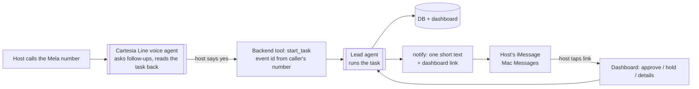
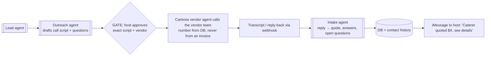

# Mela: phone call → iMessage → dashboard

Draft, Oct 23 2026. Builds on `docs/multi-agent-harness.md`.

## The loop

**Update (Oct 23):** the web form is now the main way in. The host picks how Mela reaches them, **"call me" (Cartesia calls the host) or "text me" (iMessage)**, and every update goes out that way. Vendor and venue data live in SpacetimeDB. When the host picks specific vendors, the Lead asks them through Cartesia vendor calls (Fetch.ai vendor agents later, if needed), then sends the answers back on the host's channel. Calling Mela still works as a second way in.


The host **calls Mela** and asks for something in plain words. The agents do the work, the host **gets an iMessage** with the result, and the **dashboard** holds everything in full.



## Who does what

| Part | Pick | Why | Fallback |
|------|------|-----|----------|
| Phone call | **Cartesia Line** with a Cartesia-managed number (inbound) | Sponsor track. Gives the number, speech-to-text, voice and turn-taking in one, and calls our backend as a tool | Twilio number assigned to the Cartesia agent; or the web voice button |
| Texts | **Mac Messages app** for the demo (Sendblue later) | Real blue-bubble iMessage sent from the demo Mac via AppleScript; replies read from its Messages database. No signup needed | Twilio SMS (arrives in Messages as green SMS) |
| Outbound calls to vendors | **Cartesia Line**, same stack, outbound from the managed number | One voice stack for both directions; we write the agent, so it reads exactly the approved script. Strengthens "Best Use of Cartesia" | Draft marked "not sent"; host calls themselves |
| Dashboard | Next.js, same event ID | Full detail lives here; texts are just pointers | – |

## Vendor calls (Cartesia)

Cartesia handles both sides: the host calls in, and the agent calls vendors out. They're two Line agents (host agent, vendor agent) sharing one backend.



- The vendor agent only asks the approved questions. It can't agree to prices, dates or terms on the host's behalf; anything like that comes back as "vendor proposed X".
- Every call keeps its transcript, time and outcome in the vendor's contact history.
- Hyphenate case 2 (changed bank details): the vendor agent calls the number **already on file** to verify. The planner still has to clear the hold.
- Fallback: the Outreach draft shows as "not sent", and the host can call the vendor themselves.

## What the call can and can't do

- **Can:** start or change a task ("find a caterer that does vegetarian for 100", "move the date to May"), ask for status, and confirm the brief out loud (gate G1).
- **Can't:** approve spending, release a held invoice, or approve outreach. Caller ID can be faked, so those approvals happen on the dashboard (signed-in host) only. The voice agent says, "I've sent you a link to approve that."
- The voice agent never runs research itself. It calls one backend tool, `start_task(eventId, request)`, and the Lead agent does the rest. Matches the planning doc: *Cartesia confirms and calls the backend; it does not scrape.*

## Texts the host gets

**Updated Oct 24.** Every text comes from a fixed template in `src/lib/notify.ts`. The Lead agent never writes the words: it picks which message to send, and code fills in names, dates and amounts from the event state.

### Tone rules

- No emoji, no exclamation marks, no slang. Short, complete sentences, like a good human planner.
- Use the host's first name in the first text only. After that, get straight to the point.
- The first text says Mela is an AI assistant. Never pretend to be a person.
- Every amount, date and name comes from code (the quote, the plan, the payment), never from the model.
- Never guess: an unknown price or date is said to be unknown.
- At most one text per state change (the plan summary and payment receipts excepted). Under 320 characters, except the plan summary.
- No guest personal data, card details or full addresses in texts. The dashboard link carries the details.

### Templates

`{braces}` are filled by code. `{code}` is the 4-digit approval code.

| # | When | Text |
|---|------|------|
| T1 | Request received | "Hi {firstName}, this is Mela, an AI planning assistant. I have your request for a {eventType} for {guests} guests in {city} on {date}. I'll call you shortly to confirm the details. Reply STOP at any time to stop texts." |
| T2 | One detail missing | "To find the right options, I need one more detail: {question}" |
| T3 | Brief confirmed | "Your details are confirmed. I'm now contacting venues, caterers and decorators, and I'll text you after each conversation." |
| T4a | Vendor quote | "{vendor} is available on {date}. Quoted price {price}, deposit {deposit}." |
| T4b | Vendor unavailable | "{vendor} is not available on your date. I'll move to the next option." |
| T4c | No firm price | "{vendor} did not give a firm price, so I've marked it as unknown rather than guess." |
| T5 | Plan approval | "Here is your plan.<br>Venue: {venue}, {price}<br>Catering: {caterer}, {price}<br>Decor: {decor}, {price}<br>Total {total} of your {budget} budget. Deposits due now: {deposits}.<br>To book and pay the deposits, reply YES {code}. To cancel, reply NO {code}. This code expires in 30 minutes." |
| T6 | Approved | "Thank you. Your plan is approved. I'm booking the vendors and paying the deposits now." |
| T7a | Deposit paid | "Deposit of {amount} paid to {vendor}. Reference {ref}." Add "(test payment)" when simulated or sandbox. |
| T7b | Deposit failed | "The deposit to {vendor} did not go through. Nothing was retried or charged twice. A planner will check it with you." |
| T8 | All booked | "Everything is booked: {n} vendors confirmed. Your full summary is here: {link}" |
| T9 | Declined (NO) | "Understood. Nothing has been booked or paid. A planner will contact you to adjust the plan." |
| T10 | Code expired | "That approval code has expired, so nothing was booked. I'll send you a new one." |
| T11 | Unknown code | "I couldn't match that code to an open request. Please reply with the code from my most recent message." |
| T12 | Question with choices | "{question}<br>1. {option1}<br>2. {option2}<br>Please reply with the number of your choice." |
| T13 | Unclear reply | "Sorry, I didn't understand that. Please reply with {validChoices}." |
| T14 | Reminder (once) | "A reminder: I'm waiting for your answer on {topic} before I continue. {link}" |
| T15 | Planner handoff | "I've passed this to a planner on our team, who will contact you shortly." |
| T16 | STOP | "You won't receive any more texts from Mela. You can still follow your event here: {link}" |
| T17 | HELP | "This is Mela, an AI event planning assistant. Reply STOP to stop texts. To reach a person, reply PLANNER." |
| T18 | Vendor call approval (optional, see below) | "Before I call {vendor}, here is what I'll ask: {questions}. I'll say I'm an AI assistant and that the call is recorded. Reply YES {code} to approve the call, or NO {code}." |
| V1 | To vendor, after payment | "Hello {vendor}, this is Mela, an AI assistant booking for a client. The {eventType} on {date} is confirmed. A deposit of {amount} has been sent, reference {ref}." |

### How a reply is checked (authentication)

Checked in this order by code (`approvals.ts`, `events.ts`), before any agent sees the text:

1. **STOP / HELP / PLANNER** are handled first, from any known number. STOP is saved on the event, and no more texts go out.
2. **Sender:** the reply must come from the host's phone number on file (`event.hostPhone`, set from the web form, never by an agent). Any other number is logged and ignored, with no reply, so a stranger learns nothing.
3. **Approvals (booking, money, vendor calls):** only **YES or NO plus the exact 4-digit code** from the latest message counts. The code belongs to one approval, is used once, and expires after 30 minutes. A plain "yes" without the code never approves anything. It goes to the Lead as an ordinary message.
4. **Choice questions (T12):** a number from the list, or the option's exact words, is accepted. Anything else gets T13 once, then the planner. Only one open question per host at a time, so a reply always answers the right question.
5. **No reply never means yes.** One reminder (T14), then the planner (T15). Quiet hours are 9am–8pm in the host's time zone.
6. **Calls never approve.** A "yes" on a phone call doesn't move money or book anything.
7. Every inbound text and its outcome is written to the audit log.

### Open decisions

- **Vendor call approval (T18):** the demo flow calls vendors without asking the host first, so the host only touches their phone twice. T18 adds one more approval with its own code. Recommended: off for the demo, on for real hosts.
- **Where the backend runs:** the demo-flow design runs the backend on the Mac. If Mela runs on Azure, texts go through the SpacetimeDB bridge (see "Texting bridge" below).
- **`notify_host` tool:** it currently takes free text from the Lead. Change it to take a template id (T3, T4b, T14, T15) so the agent can't write its own messages.

## Backend pieces

```
src/integrations/
  cartesia.ts     voice agent config + start_task webhook handler
  imessage.ts     sendText(to, body), pollReplies()  → falls back to twilio SMS
src/app/api/
  voice/start-task/route.ts   called by the Cartesia agent; verifies Cartesia's signature
src/lib/notify.ts             decides when to text (state change → template above)
src/lib/texting.ts            textHost(), onHostReply(): Mela's side of texting, through SpacetimeDB
relay/mac-relay.ts            runs on the demo Mac only (npm run relay)
spacetimedb/spacetimedb/      outbox + inbox tables (private), role-locked reducers
```

**Texting bridge (Oct 24).** Mela runs on Azure; iMessage only works on the demo Mac. They never talk directly:
Mela → `queueText` → **outbox** → Mac relay sends with iMessage → `markSent`. Host reply → relay → `receiveText` → **inbox** → Mela handles it → `markHandled`.
The Mac only makes outgoing connections (no tunnel, no open port). Texts queued while the Mac is offline send when it's back. Only the identity holding the `app` role can queue texts, and only the `relay` can report sends or store replies; the tables are private and each side sees only its own view. A host's text reply is still never an approval.

`notify.ts` is plain code reacting to event state changes, not an agent. That keeps the texts predictable.

## Demo script

1. Presenter calls the Mela number on speaker: "I'm planning an outdoor quinceañera in SF for about 100 people…"
2. Cartesia asks 1–2 follow-ups, reads the brief back, presenter says "yes".
3. Phone buzzes: "Got it…". Dashboard (on the projector) shows research running.
4. Phone buzzes: "3 venues fit…". Presenter taps the link and the shortlist opens.
5. Later: "Held the caterer's invoice…" → tap → approve 100 guests, dispute the charge.

## Ask / check

1. **Cartesia booth:** confirm Line + managed numbers are available on hackathon credits, and that the agent can call our webhook mid-call.
2. **iMessage (Oct 24):** Sendblue needs a sales demo first, so for the hackathon we send real iMessages from the demo Mac's Messages app (`src/integrations/imessage.ts`). Sendblue later.
3. Demo phones must be on the allowed-recipient list for whichever texting service we use.
